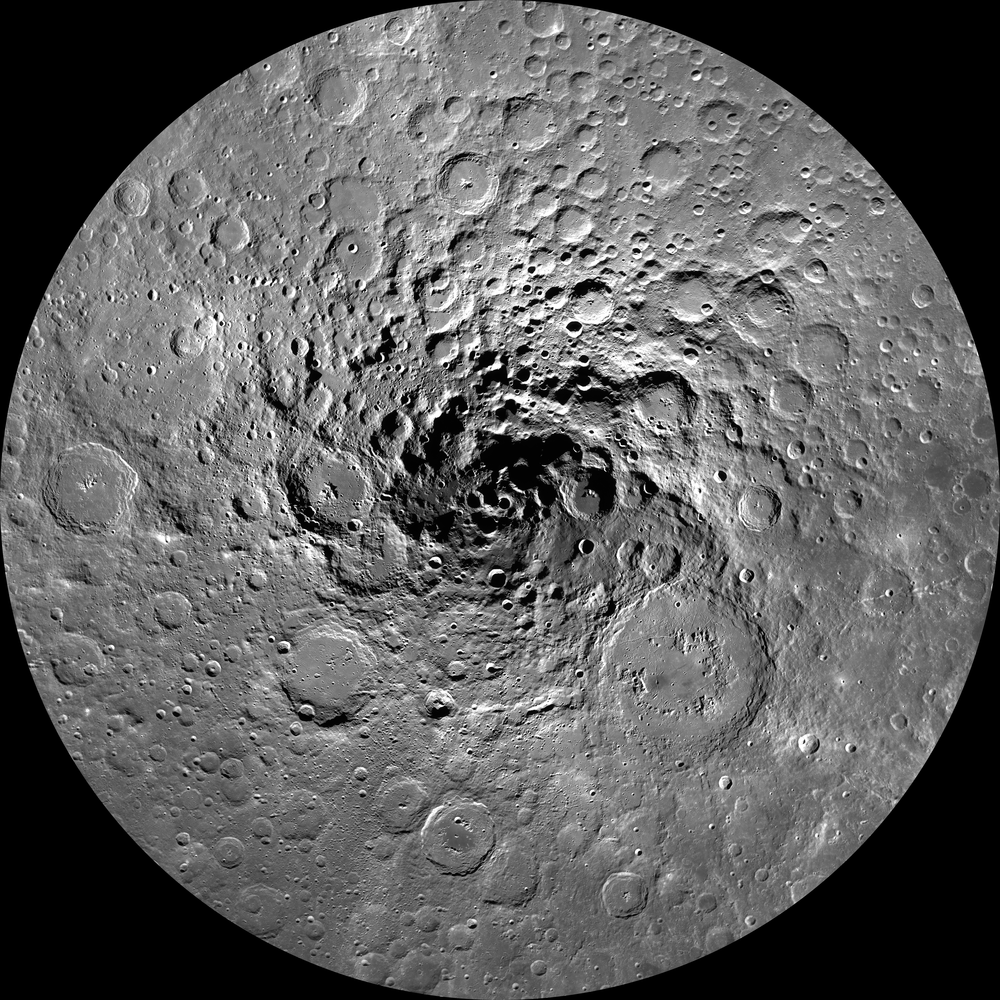

# RIMLIGHT — Lunar South Pole Illumination, Comms & Mission Planner

**Interactive 3D/2D Lunar South Pole mission planner that raytraces NASA LOLA 80 m/px terrain against NAIF SPICE DE440 ephemerides (2026–2032) to compute solar power balance, Direct-to-Earth (DTE) comms, battery sizing, and Artemis III landing eligibility at any coordinate south of 80°S.**



---

## Live Links

- **Live Web App (Vercel):** [https://rimlight.vercel.app](https://rimlight.vercel.app)
- **Live FastAPI + SPICE/LOLA Backend (Railway):** [https://nasa-space-apps-2026-production.up.railway.app/health](https://nasa-space-apps-2026-production.up.railway.app/health)
- **Curated Sites API:** [https://nasa-space-apps-2026-production.up.railway.app/sites](https://nasa-space-apps-2026-production.up.railway.app/sites)

---

## Who It's For

- **Artemis III & CLPS Mission Planners** evaluating landing sites against NASA's south pole sunlight, Direct-to-Earth (DTE) radio, slope, and latitude rules.
- **Lander & Rover Power/Comms Engineers** sizing solar arrays, solar mast heights (`2–50 m`), and batteries for multi-day lunar night gaps.
- **Lunar Researchers & Space Apps Judges** comparing candidate sites side-by-side with verifiable SPICE + LOLA physics.

---

## Validation vs. Published Literature & NASA References

| Benchmark / Reference | Metric & Site | RIMLIGHT Result | Reference Value | Notes |
| :--- | :--- | :--- | :--- | :--- |
| **Gläser et al. (2014)**, *Icarus* 243, 78–90 | Connecting Ridge peak (`CR1`), `2 m` mast | **92.17%** | **92.27%** | `0.10%` diff using 80 m/px LOLA DEM |
| **Gläser et al. (2014)**, *Icarus* 243, 78–90 | Connecting Ridge peak (`CR1`), `10 m` mast | **95.79%** | **95.65%** | `0.14%` diff using 80 m/px LOLA DEM |
| **ESA Connecting Ridge** | `(-89.4667°, -136.6667°)`, `2 m` mast (2026–2032) | **84.3% sun** · **39.45% Earth** | ESA reference site | Longest night `217.5 h`, longest day `5,530.3 h` |
| **NASA JPL Horizons (`DE440`)** | Sub-solar & sub-Earth az/el (`315,576` steps) | **< 0.05° RMS error** | JPL Horizons truth | Verified in `MOON_PA_DE440` (`tests/test_core.py`) |

---

## Key Features

- **Dual 3D Moon Globe & 2D LOLA Polar Stereographic Map (`80°S–90°S`):** Click any coordinate inside `80°S–90°S` for live 720-ray (`0.5°` azimuth, `200 km` range) horizon raytracing with lunar curvature drop ($d^2 / 2R_{\text{Moon}}$).
- **Artemis III Eligibility Checklist & Nearby Optimizer:** Checks **Earth ≥ 25%**, **Sun ≥ 5%**, **Slope < 10° (100 m baseline)**, and **Lat ≤ -84°S**, with one-click **Find Nearest Eligible Spot** (`/nearby`).
- **Power, Battery & Mission Planner:** Configurable landing UTC, stay duration (`1–60 d`), power draw (`W`), solar panel area (`m²`), mission presets (`CLPS Lander`, `Artemis Crew`, `Long-Stay Rover`), daily sunlight/Earth charts, and 6-year best-date ranking.
- **360° Horizon Panorama & Mast Trade-Offs:** Interactive skyline with Sun/Earth tracks, `1 m` boulder shadow length readout, and `2 / 5 / 10 / 20 / 50 m` mast comparison.
- **Exports & Side-by-Side Compare:** `.ics` sunrise/sunset/blackout calendar export, high-res `.png` mission card download, and multi-site `.csv` comparison export.

---

## Data Sources

- **LRO LOLA South Pole DEM (`LDEM_80S_80MPP_ADJ.TIF`):** Smith, D. E., Zuber, M. T., Neumann, G. A., et al. (2010). NASA Planetary Geodynamics Data Archive (PGDA Product 90), GSFC — [https://pgda.gsfc.nasa.gov/products/90](https://pgda.gsfc.nasa.gov/products/90)
- **NAIF SPICE Kernels (`de440.bsp`, `moon_pa_de440_200625.bpc`, `moon_de440_250416.tf`, `pck00011.tpc`, `naif0012.tls`):** Acton, C. H. (1996); Park, R. S., et al. (2021). NASA NAIF — [https://naif.jpl.nasa.gov/pub/naif/generic_kernels/](https://naif.jpl.nasa.gov/pub/naif/generic_kernels/)
- **LRO WAC Global Lunar Mosaic:** NASA Scientific Visualization Studio (SVS #4720) & ASU LROC Team.

---

## How to Run Locally (Including Data Downloads)

### 1. Backend (`FastAPI` + `SPICE` + `LOLA`)
```bash
python -m venv .venv
# Windows: .venv\Scripts\activate
# macOS/Linux: source .venv/bin/activate
pip install -r requirements.txt

# Downloads NASA SPICE kernels + LOLA 80 m/px DEM (~1.1 GB total) and precomputes the 7 curated sites:
python backend/bootstrap_data.py

# Start the API server on http://localhost:8000
uvicorn app:app --app-dir backend --host 127.0.0.1 --port 8000 --reload
```

### 2. Frontend (`React` + `Vite` + `Three.js` + `Leaflet`)
```bash
cd frontend
npm install
npm run dev        # Opens http://localhost:5173
```

### 3. Automated Tests (`pytest`)
```bash
python -m pytest tests/test_core.py tests/test_metrics.py
```

---

## Known Limits & Assumptions

- **Coverage:** High-resolution LOLA terrain raytracing covers **`80°S–90°S`** only; coordinates north of `80°S` fall back to flat-horizon ephemeris angles.
- **Resolution:** `LDEM_80S_80MPP_ADJ.TIF` has `80 m/px` horizontal spacing, so sub-80 m boulders/micro-craters are not resolved in the skyline.
- **Time Window & Cadence:** `2026-11-13 00:00 UTC` to `2032-11-12 00:00 UTC` at 10-minute steps (`315,576` steps).
- **Engineering Assumptions:** `2°` DTE radio clearance margin above terrain, `30%` solar cell efficiency, and `1361 W/m²` solar constant scaled by $1/r_{\text{AU}}^2$.

---

## Team

Built for the **NASA Space Apps Challenge 2026** by:
- **Kerolos Emad**
- **Lydia Salib**
- **Michael**
- **Youssef Naguib Mourad**

---

## License

Released under the [MIT License](./LICENSE).
